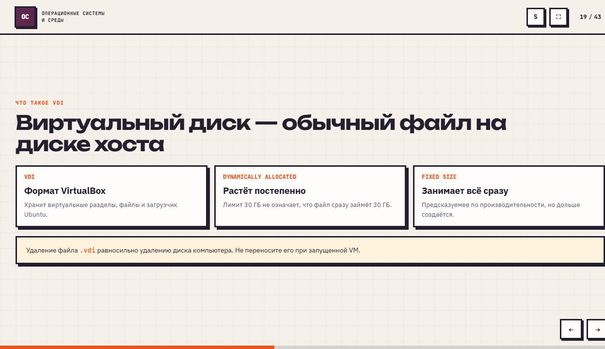
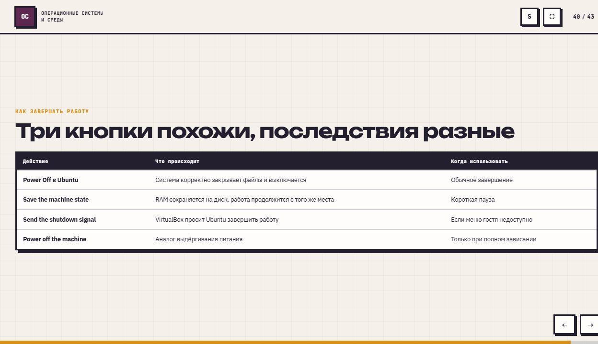

# Установка Ubuntu в VirtualBox

## Виртуальная машина

**Виртуальная машина (VM)** - отдельный компьютер с виртуальными процессором, памятью, диском, сетью и экраном. **Хост** - физический компьютер и его основная ОС; **гость** - ОС внутри VM. VirtualBox управляет виртуальным оборудованием и выделяет ему ресурсы хоста.

**ISO** - образ установочного носителя. Он запускает установщик или Live-среду. Live-среда работает без установки; её изменения обычно не сохраняются после выключения. Установленная Ubuntu хранится на виртуальном диске.

Архитектура гостевой системы должна соответствовать платформе: для Intel/AMD используется `amd64`, для Apple Silicon - `arm64`. VirtualBox на ARM-хосте не эмулирует гостевой процессор x86.

## Ресурсы и виртуальный диск

Оперативная память и процессорное время делятся между хостом и гостем. Учебный профиль: 4-6 ГБ RAM, 2 CPU, диск 30 ГБ. Выделение слишком большой доли ресурсов замедляет основной компьютер.

**VDI** - файл виртуального диска на хосте. Внутри находятся разделы, файлы и загрузчик гостевой ОС. Динамический диск растёт по мере записи данных до заданного предела; фиксированный сразу занимает весь выделенный объём.

**NAT** позволяет гостю обращаться к сети через хост. Виртуальный DHCP-сервер выдаёт сетевые параметры автоматически. Гость видит виртуальные устройства, с которыми работают его драйверы.

## Интеграция и состояние VM

**Guest Additions** - дополнения внутри гостевой ОС: автоматическое изменение разрешения, общий буфер обмена и другие функции интеграции. Общие папки связывают выбранные каталоги хоста и гостя. На ARM-платформе набор поддерживаемых функций может отличаться.

**Снимок (snapshot)** сохраняет состояние VM для возврата к нему после изменений. **Сохранённое состояние** позволяет продолжить текущую работу с того же места, сохраняя содержимое RAM на диск.

Корректное завершение закрывает файлы и останавливает ОС. Сигнал выключения просит гостя завершить работу. Принудительное выключение соответствует потере питания и может привести к утрате незаписанных данных.

