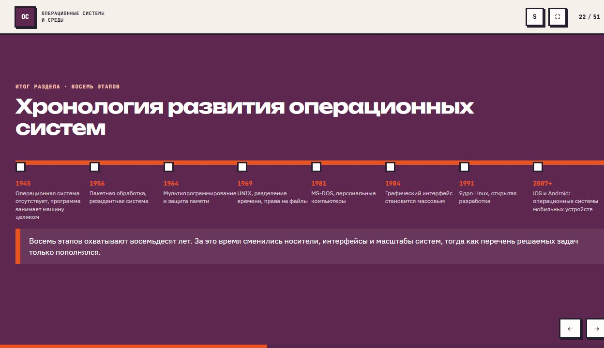
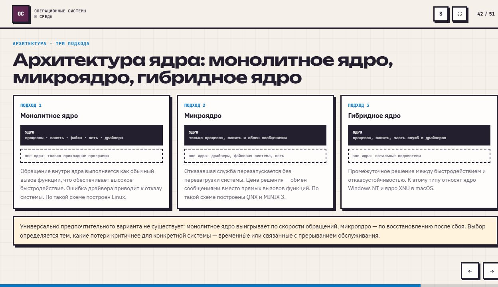

# История, назначение и виды операционных систем

## Назначение ОС

**Операционная система** - комплекс программ, управляющий ресурсами компьютера и предоставляющий их приложениям через единый интерфейс. Ресурсы: процессорное время, память, дисковое пространство, устройства и сеть.

ОС выполняет две роли: **расширенная машина** скрывает детали оборудования за понятиями файла, процесса и соединения; **распределитель ресурсов** определяет порядок их использования и защищает программы друг от друга.

Уровни системы: пользователь → приложения → ОС → оборудование. **Ядро** управляет ресурсами в привилегированном режиме. Приложения, оболочка и многие службы работают в пользовательском режиме. **Системный вызов** передаёт запрос ядру, которое проверяет полномочия, выполняет операцию и возвращает результат.

## Развитие ОС

- **1945-1955:** ОС нет; программа занимает всю машину и самостоятельно взаимодействует с оборудованием.
- **1956:** пакетная обработка автоматически запускает задания по очереди и сокращает простой между ними.
- **1960-е:** мультипрограммирование размещает несколько программ в памяти; пока одна ждёт ввод-вывод, выполняется другая. Возникают планирование и защита памяти.
- **1961-1969:** разделение времени даёт пользователям короткие интервалы работы процессора; появляются интерактивные терминалы и разграничение доступа.
- **1969-1973:** UNIX и перенос ядра на C облегчают поддержку разных архитектур; развиваются утилиты, конвейеры и права на файлы.
- **1981-1984:** персональные компьютеры, MS-DOS и массовый графический интерфейс.
- **1991:** ядро Linux и открытая разработка.
- **2007-2008:** мобильные ОС iOS и Android.

## Основные функции

| Функция | Содержание |
| --- | --- |
| Процессы | Создание, завершение, состояния, распределение CPU |
| Память | Выделение страниц, виртуальные адреса, изоляция и подкачка |
| Файлы | Имена, каталоги, данные и метаданные |
| Устройства | Драйверы, единый интерфейс и обработка прерываний |
| Защита | Учётные записи, права и проверка доступа |
| Интерфейс | Командная оболочка и графическая среда |

**Процесс** - запущенная программа со своей памятью и состоянием. На одном ядре процессы чередуются; переключение контекста сохраняет состояние одного процесса и восстанавливает другое. **Виртуальная память** отделяет адреса программы от физического размещения данных.

Загрузка системы проходит через прошивку UEFI, загрузчик GRUB, ядро и первый процесс `systemd`, который запускает службы. События работы регистрируются в системном журнале.

## Классификация и устройство

ОС различают по числу задач и пользователей, назначению, интерфейсу, разрядности, требованиям к времени реакции и лицензии. Назначение бывает настольным, серверным, мобильным или встраиваемым. Интерфейс - командным, графическим или комбинированным.

При **кооперативной многозадачности** программа сама отдаёт управление. При **вытесняющей** её прерывает ОС. **Реальное время** означает гарантию срока ответа: в жёсткой системе нарушение срока считается отказом, в мягкой снижает качество.

**Монолитное ядро** объединяет основные подсистемы и драйверы; **микроядро** выносит многие службы за пределы ядра; **гибридное** сочетает подходы. Различия связаны с затратами на взаимодействие и восстановлением после сбоев.

Windows использует линию NT, macOS и iOS - XNU, Android - Linux. Linux - ядро; **дистрибутив** добавляет системные программы, оболочку, менеджер пакетов и окружение. Ubuntu и Debian используют `apt`, Fedora - `dnf`, Arch - `pacman`; дистрибутивы отличаются составом и политикой обновлений. Открытая лицензия допускает изучение, изменение и распространение кода по её условиям; она не обязательно означает бесплатную поддержку.
