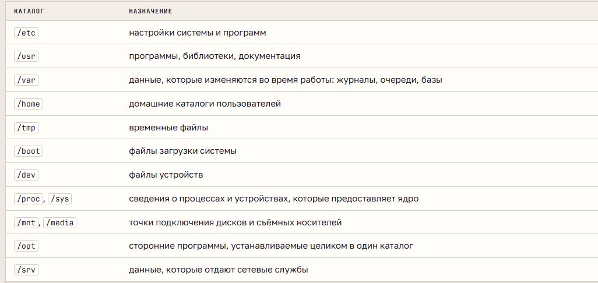
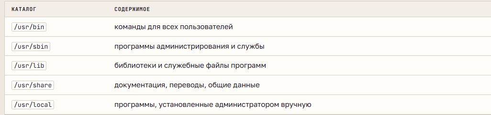

# Файловая система Linux и FHS

## Дерево каталогов и пути

Все доступные файлы Linux образуют единое дерево с корнем **`/`**. Диски и другие хранилища подключаются к его каталогам. `/root` - домашний каталог администратора, а не корень дерева.

**Абсолютный путь** начинается с `/` и не зависит от текущего каталога. **Относительный** отсчитывается от текущего каталога: `.` обозначает его самого, `..` - родительский. `~` обозначает домашний каталог пользователя, обычно `/home/имя`. Регистр букв в именах различается; начальная точка делает имя скрытым, но не меняет права доступа.

Терминал отображает текст и передаёт ввод, **оболочка** разбирает команды и запускает программы. Команда включает имя, ключи и аргументы. `pwd` показывает текущий каталог, `cd` меняет его, `ls` выводит содержимое.

## Стандарт FHS

**FHS (Filesystem Hierarchy Standard)** определяет назначение основных каталогов. Файлы распределяются по типу данных: программа, настройки и журналы одной службы находятся в разных местах.

В `/etc` находятся настройки системы и служб. В `/usr` - программы, библиотеки и общие данные; `/usr/local` предназначен для программ, установленных администратором отдельно от пакетов дистрибутива.

**PATH** - список каталогов поиска исполняемых файлов, разделённых двоеточиями. Оболочка ищет внешний исполняемый файл по порядку и выбирает первый найденный. Встроенные команды выполняет сама оболочка. Имя с `/` задаёт путь напрямую. В современной Ubuntu `/bin`, `/sbin` и `/lib` - ссылки на соответствующие каталоги `/usr`.

## Изменяемые данные и сведения ядра

`/var/lib` хранит постоянные данные программ, `/var/log` - журналы, `/var/cache` - восстанавливаемый кэш, `/var/spool` - очереди заданий. `/tmp` предназначен для кратковременных файлов, `/var/tmp` сохраняет временные файлы между перезагрузками. `/run` содержит данные текущего запуска и очищается при загрузке.

**tmpfs** хранит файлы в оперативной памяти. **proc** и **sysfs** предоставляют сведения ядра через псевдофайлы: `/proc` - о процессах и состоянии системы, `/sys` - об устройствах и драйверах. В `/dev` находятся специальные файлы устройств: символьные передают поток байтов, блочные - блоки данных.

## Файлы, inode и ссылки

Первый символ в `ls -l` обозначает тип объекта: `-` - обычный файл, `d` - каталог, `l` - символическая ссылка, `c` и `b` - устройства, `s` - сокет. Содержимое обычного файла определяет `file`, а не расширение имени.

**inode** хранит тип, права, владельца, размер, времена и расположение данных. Имя хранится в каталоге как соответствие «имя → номер inode».

**Жёсткая ссылка** - ещё одно равноправное имя того же inode в одной файловой системе. Удаление одного имени не уничтожает данные, пока остаются другие ссылки. **Символическая ссылка** имеет свой inode и хранит путь; может вести на каталог или в другую файловую систему. При исчезновении цели она становится неработающей.

## Монтирование и объём

**Монтирование** подключает файловую систему к каталогу - точке монтирования. Прежнее содержимое каталога временно скрывается и снова видно после отключения. Основные типы: `ext4`, `tmpfs`, `proc`, `sysfs`.

`findmnt` показывает подключения, `lsblk` - диски и разделы. `ls -lh` показывает размер файла, `du` - занятое место, `df` - ёмкость и свободное место файловой системы. Свободные inode тоже необходимы для создания новых файлов.
