# Файловая система Linux и FHS

Практика выполнена в Ubuntu. В отчёте показаны основные каталоги Linux, виртуальные файловые системы, ссылки, использование места и монтирование `tmpfs`.

## Корневой каталог

Команды `pwd` и `ls -lah /` показывают начало дерева файловой системы и содержимое корневого каталога.

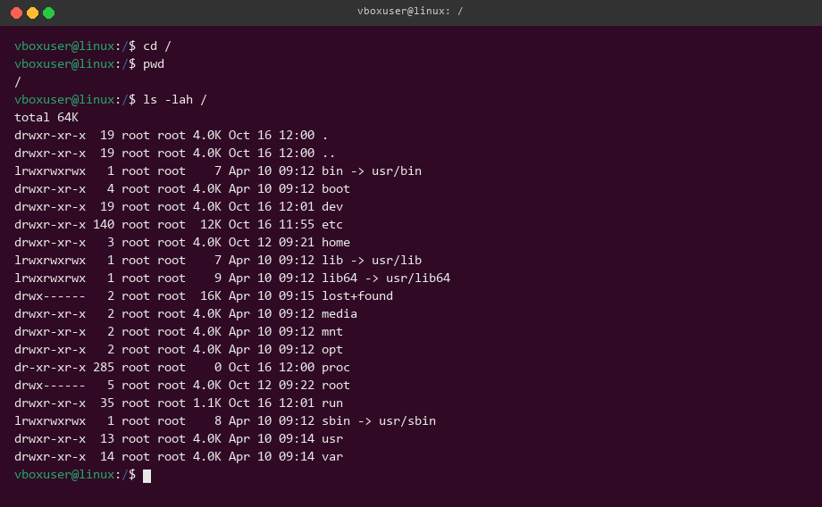

## Домашний каталог

Команда `cd ~` переходит в домашний каталог. Ключ `-a` показывает имена, начинающиеся с точки.

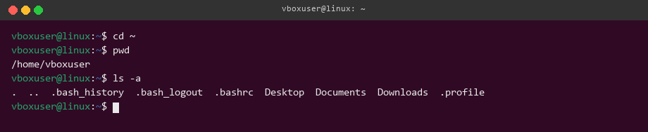

## Системные настройки

В `/etc/os-release` хранится информация о системе. Команда `getent passwd` показывает записи пользователей.

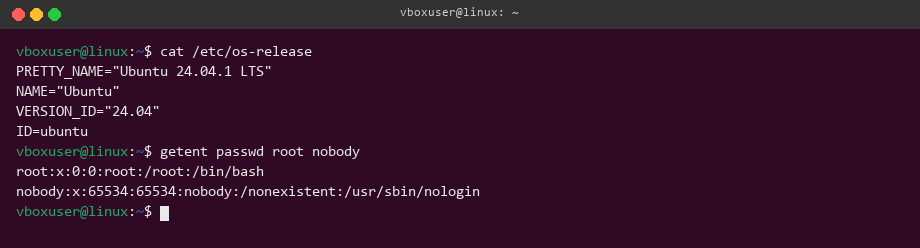

## Программы и PATH

Внешние программы ищутся в каталогах из `PATH`. Команда `cd` встроена в оболочку.

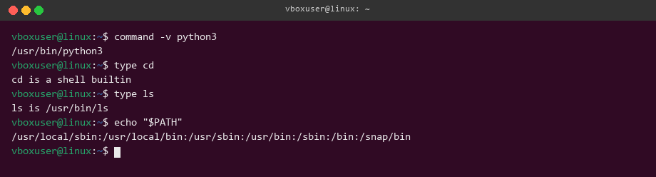

## Изменяемые данные

Каталог `/var` содержит журналы, кэш и постоянные данные программ. `/run` используется для данных текущего запуска системы.

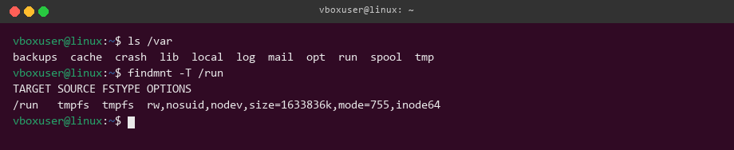

## Устройства

`/dev/null` является символьным устройством. Нулевой код завершения означает успешное выполнение команды.

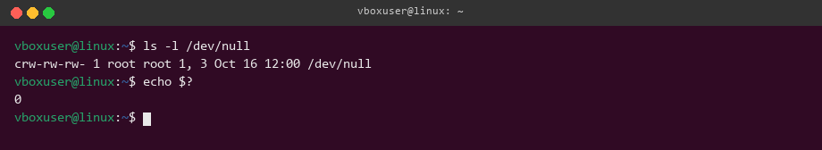

## Файлы proc

Значение `/proc/uptime` меняется при каждом чтении. Обычная копия сохраняет значение на момент выполнения `cp`.

## Сетевые интерфейсы

В `/sys/class/net` видны сетевые интерфейсы системы. `lo` используется для локального обмена.

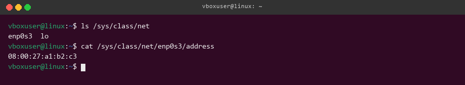

## inode и ссылки

Жёсткая ссылка имеет тот же inode и продолжает работать после удаления исходного имени. Символическая ссылка хранит путь и становится недействительной.

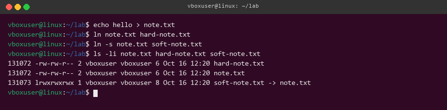

## Использование диска

`df` показывает место в файловой системе, а `du` считает размер выбранных файлов и каталогов.

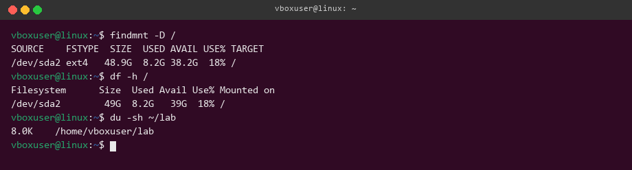

## Монтирование tmpfs

После монтирования `tmpfs` прежнее содержимое каталога временно скрывается.

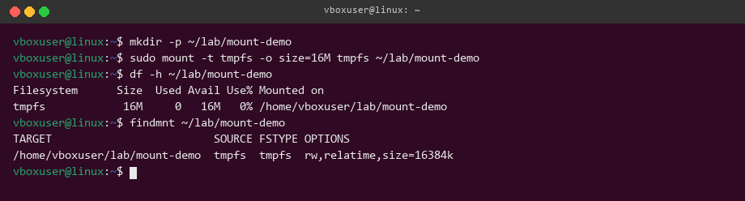

## Отключение tmpfs

После `umount` исходный файл снова виден, а файл из временной файловой системы пропадает.

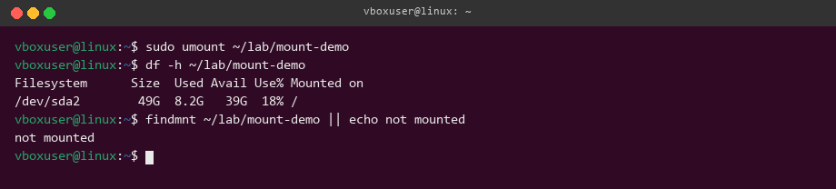

## Размещение файлов службы

Настройки службы размещаются в `/etc`, постоянные данные в `/var/lib`, а журналы в `/var/log`.

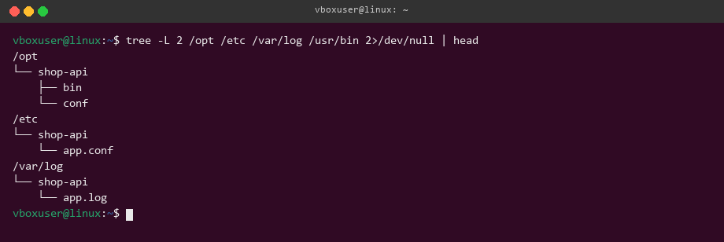

## Пример для backup-agent

| Файл | Путь |
| --- | --- |
| Программа | `/usr/local/bin/backup-agent` |
| Настройки | `/etc/backup-agent/agent.conf` |
| Журнал | `/var/log/backup-agent/agent.log` |
| Каталог копий | `/var/lib/backup-agent/catalog.json` |
| PID | `/run/backup-agent/agent.pid` |
