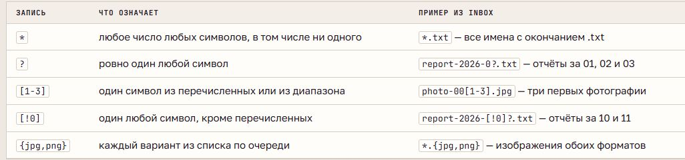
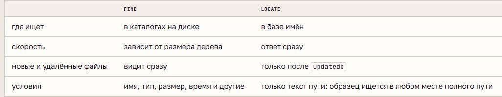

# Файлы, маски, поиск и справка

## Операции с файлами

| Команда | Назначение и особенности |
| --- | --- |
| `mkdir` | Создаёт каталог; `-p` создаёт недостающие уровни пути |
| `touch` | Создаёт пустой файл или обновляет временные отметки; `-d` задаёт дату |
| `cp` | Копирует; `-r` обходит содержимое каталога рекурсивно |
| `mv` | Перемещает или переименовывает |
| `ln -s` | Создаёт символическую ссылку |
| `rm` | Удаляет имена файлов без помещения в корзину; `-r` удаляет дерево |
| `rmdir` | Удаляет только пустой каталог |

`cp` и `mv` могут заменять существующие файлы. Ключ `-i` запрашивает подтверждение, `-n` предотвращает замену, `-v` выводит выполненные действия. У `rm` ключ `-f` отключает вопросы и игнорирует отсутствие файла.

При перемещении внутри одной файловой системы меняется запись каталога. Между файловыми системами данные копируются, затем исходный файл удаляется. Копия имеет независимое содержимое, ссылка ведёт к текущему содержимому цели.

Пробел разделяет аргументы команды. Кавычки или экранирование сохраняют пробел внутри имени файла как часть одного аргумента.

## Маски имён

**Маска (glob)** - шаблон, который оболочка заменяет подходящими именами **до запуска команды**. `*` означает любое число символов, `?` - один символ, `[ ]` - один символ из набора, `[! ]` - исключение. Фигурные скобки создают варианты слов и раскрываются до масок.

В обычной конфигурации Bash маска без совпадений остаётся неизменной. Кавычки запрещают раскрытие маски оболочкой. Начальную точку скрытого имени нужно указывать явно. Маски отличаются от регулярных выражений своими правилами. Лишний пробел способен превратить один шаблон в два аргумента.

## Поиск

**find** обходит дерево от заданного каталога. Условия: `-name` - имя с учётом регистра, `-iname` - без него, `-type` - тип, `-size` - размер, `-mtime` - возраст изменения в полных сутках, `-mmin` - в минутах. `-maxdepth` ограничивает глубину. Условия подряд соединяются по правилу «и»; скрытые объекты тоже проверяются.

Маска для `-name` передаётся в кавычках, чтобы её обрабатывал сам `find`. Для размера `+N` означает больше, `-N` - меньше; перед сравнением размер округляется вверх до выбранной единицы. `-exec` выполняет действие над найденным, `-delete` удаляет. Порядок условий и действий влияет на результат.

**locate** ищет по базе путей, которую обновляет `updatedb`. Результат быстрый, но может быть устаревшим; `-e` проверяет существование найденного пути.

`which` ищет исполняемый файл в PATH. `type` различает файл, псевдоним и встроенную команду; `command -v` показывает, как оболочка разрешает имя. Стандартный поток ошибок имеет номер 2; `/dev/null` отбрасывает направленные в него данные.

## Справка

**man** открывает руководство установленной версии программы. Разделы страницы: `NAME` - назначение, `SYNOPSIS` - синтаксис, `DESCRIPTION` - описание, `EXAMPLES` - примеры, `SEE ALSO` - связанные страницы. Квадратные скобки в синтаксисе обозначают необязательные части, многоточие - повторение.

Разделы справочника: 1 - команды пользователя, 5 - форматы файлов, 7 - обзоры, 8 - администрирование. `man -f` показывает страницы с указанным именем, `man -k` ищет по описаниям. `--help` выводит краткую справку программы, `help` - встроенной команды оболочки. В просмотрщике `/` начинает поиск, `n` переходит к совпадению, `q` закрывает страницу.
