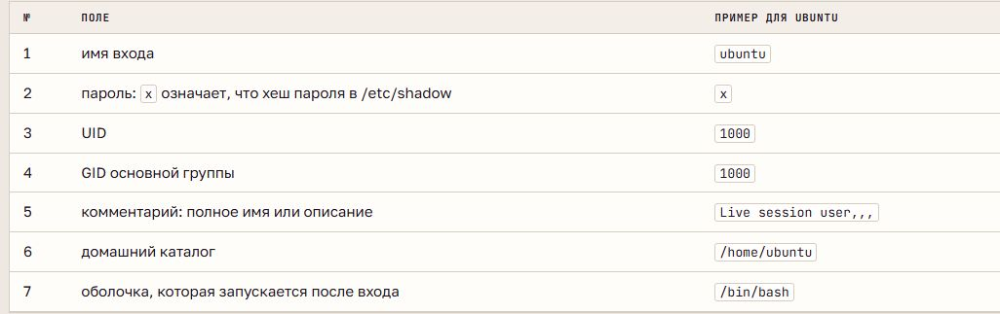
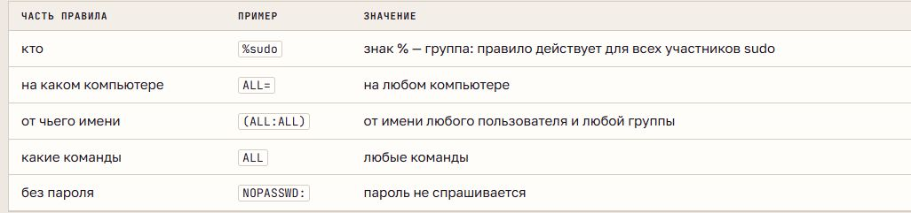

# Пользователи, группы и sudo

## Учётные записи

**Учётная запись** описывает пользователя или службу: имя, UID, основную группу, домашний каталог и оболочку. Ядро различает пользователей по числовому **UID**, группы - по **GID**. У `root` UID равен 0. В Ubuntu обычные пользователи обычно получают UID от 1000, служебные - из меньшего диапазона.

`/etc/passwd` содержит по одной строке на учётную запись и семь полей через двоеточие. `getent` читает базу учётных записей, включая настроенные внешние источники. `whoami` показывает имя текущего пользователя, `id` - его UID, GID и группы.

Служебные записи разграничивают доступ между программами. Оболочка `nologin` запрещает интерактивный вход под такой записью, но служба может работать от её имени.

## Пароли

`/etc/passwd` доступен для чтения всем, поэтому **хеши паролей** хранятся отдельно в `/etc/shadow` с ограниченным доступом. Хеш - результат одностороннего преобразования пароля с **солью**, случайным значением. При входе результат вычисляется снова и сравнивается с сохранённым. Разная соль даёт разные хеши даже для одинаковых паролей.

В `/etc/shadow` девять полей: имя, данные пароля и сроки его действия. Пустое поле означает отсутствие заданного пароля, `*` запрещает вход по паролю, начальный `!` обозначает блокировку парольного входа. Блокировка пароля не равна запрету всех возможных способов входа. `passwd` меняет пароль, `passwd -S` показывает его состояние.

## Группы и доступ

У пользователя одна основная группа и могут быть дополнительные. Основная записана в `/etc/passwd`; `/etc/group` содержит имя группы, поле пароля, GID и список дополнительных участников.

У файла есть один владелец и одна группа. В обычной модели доступа применяется одна тройка прав: владельца при совпадении UID, иначе группы при совпадении членства, иначе остальных. Эти права не складываются.

Группа `sudo` даёт административные полномочия по правилам sudo; `adm` позволяет читать определённые журналы. Членство в `sudo` само по себе не делает каждый процесс процессом root.

## Root и sudo

**Root** обладает широкими полномочиями управления системой. **sudo** запускает разрешённую команду от имени другого пользователя, обычно root. Правила находятся в `/etc/sudoers` и `/etc/sudoers.d`; `visudo` проверяет их синтаксис.

Обычно sudo проверяет пароль вызывающего пользователя, а `su` - целевого. `su -` создаёт сеанс с окружением целевого пользователя. Вызовы sudo и отказы регистрируются в журнале; команды внутри оболочки `sudo -i` автоматически не становятся отдельными вызовами sudo.

**Принцип минимальных привилегий:** процесс получает только нужные права и только на необходимое время.

## Управление учётными записями

`groupadd` создаёт группу, `useradd` - учётную запись, `adduser` в Ubuntu выполняет создание интерактивно. `/etc/skel` содержит начальные файлы домашнего каталога. `usermod -aG` добавляет дополнительные группы, а `-G` без `-a` заменяет их список; уже работающий сеанс сохраняет старое членство.

`chgrp` меняет группу файла, `chmod` - права. **Setgid** на общем каталоге передаёт его группу новым файлам. `userdel -r` удаляет запись и домашний каталог, но файлы в других местах остаются с прежним UID. Повторное использование этого UID может передать их новому пользователю.
