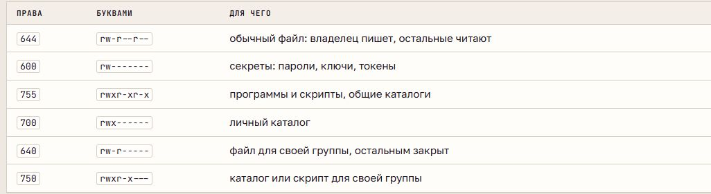
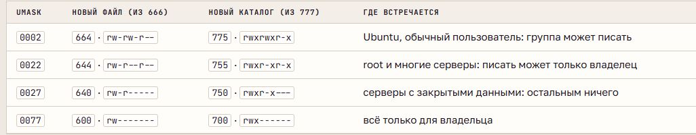

# Права доступа, владельцы и umask

## Модель прав

Права хранятся в inode вместе с UID владельца и GID группы. В строке `ls -l` первый символ обозначает тип объекта, следующие девять - три тройки **rwx**: владелец, группа, остальные. Прочерк означает отсутствие права.

Для процесса применяется первая подходящая тройка: владельца, затем группы, затем остальных. Тройки не складываются; владелец не получает более широкие права группы вместо своих.

| Право | Обычный файл | Каталог |
| --- | --- | --- |
| `r` | Чтение содержимого | Чтение списка имён |
| `w` | Изменение содержимого | Создание, удаление и переименование записей |
| `x` | Запуск как программы | Проход через каталог и обращение по имени |

Для доступа к файлу нужен проход через каталоги его пути. Для удаления записи обычно нужны `w` и `x` у содержащего каталога; право записи в сам файл этого не определяет. Скрипт, читаемый интерпретатором Bash, не требует собственного `x`, но требует чтения.

## Запись и изменение прав

**chmod** меняет права; это разрешено владельцу и root. Символьная запись включает адресата (`u`, `g`, `o`, `a`), действие (`+`, `-`, `=`) и права. `+` и `-` изменяют указанные биты, `=` задаёт тройку целиком.

В числовой записи **r = 4, w = 2, x = 1**. Каждая цифра - сумма разрешений одной тройки: `7` - rwx, `6` - rw-, `5` - r-x, `4` - r--, `0` - ---. Например, `640` соответствует rw-r-----.

**chown** меняет владельца и при необходимости группу; смена владельца требует административных полномочий. **chgrp** меняет группу: владелец может выбрать группу, в которой состоит, root - любую. Ключ `-R` распространяет изменение на дерево каталога.

## Umask

**umask** - маска процесса, снимающая биты при создании новых объектов. Уже существующие файлы она не меняет. Обычно программа запрашивает `666` для обычного файла и `777` для каталога; из запроса исключаются биты маски. Маска не добавляет отсутствующие права, включая выполнение.

Расчёт выполняется по битам, а не обычным вычитанием чисел. Маска оболочки наследуется запускаемыми процессами; изменение в подоболочке ограничено этой подоболочкой.

## Специальные биты и ACL

Дополнительная цифра перед обычными правами задаёт специальные биты:

- **Setuid - 4:** исполняемая программа получает эффективный UID владельца файла. В выводе занимает позицию `x` владельца: `s` или `S`.
- **Setgid - 2:** программа получает эффективную группу файла; на каталоге новые объекты наследуют его группу. Обозначается `s` или `S` в позиции группы.
- **Sticky - 1:** в общем каталоге удалять и переименовывать запись могут владелец файла, владелец каталога и root. Обозначается `t` или `T` в позиции остальных.

Заглавная буква показывает отсутствие соответствующего `x`. Sticky не защищает содержимое от изменения, если запись в файл разрешена.

**ACL** - дополнительные записи доступа для пользователей и групп. `setfacl` изменяет их, `getfacl` показывает. Знак `+` после прав в `ls -l` указывает на расширенный список доступа.
