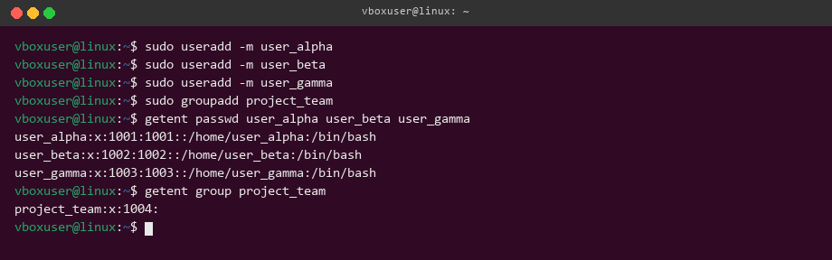
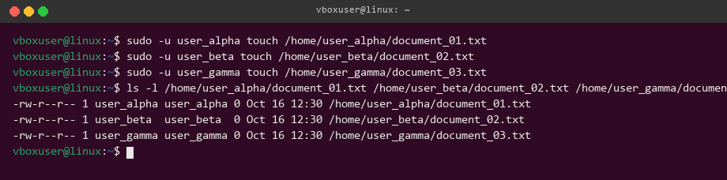
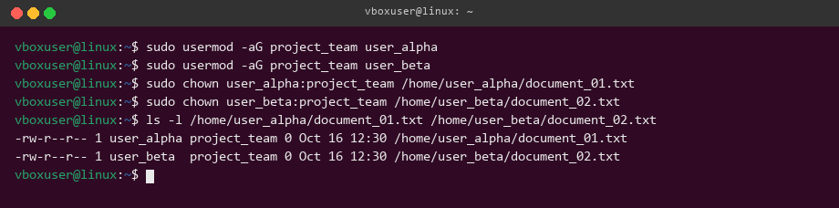
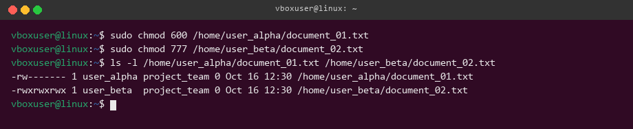
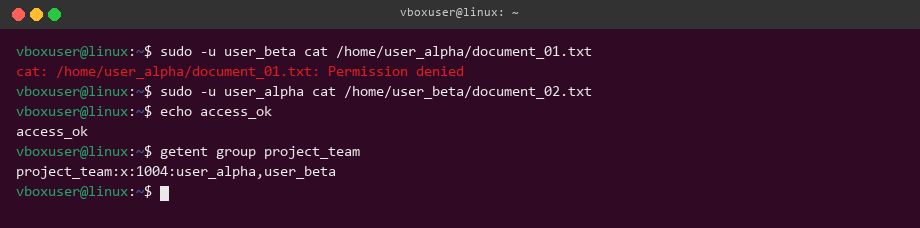

# Пользователи, владельцы и права доступа

## Создание пользователей

## Создание файлов

Файлы созданы от имени соответствующих пользователей.

## Смена владельцев

## Установка прав доступа

Для файлов установлены разные режимы с помощью `chmod`.

## Проверка

Итоговые владельцы, группы и права проверены командой `ls -l`.

