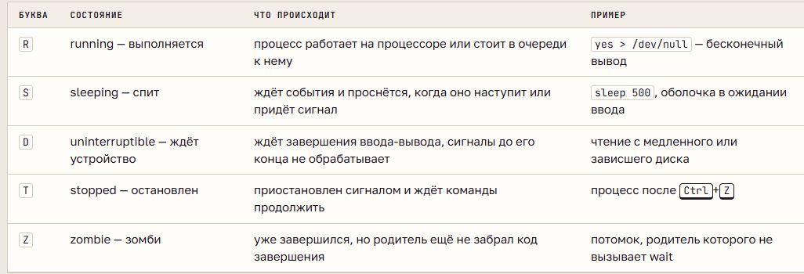
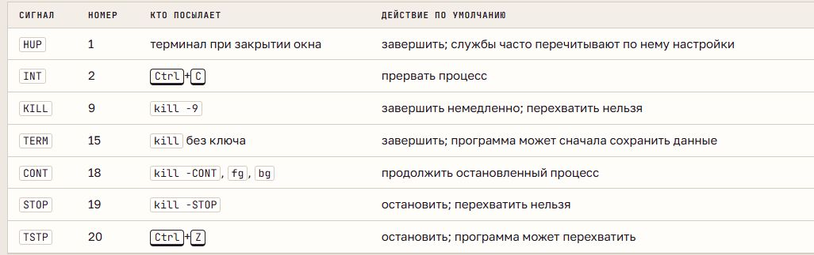

# Процессы: PID, состояния и сигналы

## Программа и процесс

**Программа** - файл с кодом. **Процесс** - её выполняющийся экземпляр: код, данные, память, открытые файлы, владелец и состояние. Одну программу можно запустить в нескольких независимых процессах.

**PID** - номер процесса, **PPID** - номер его родителя; UID обозначает пользователя. После завершения процесса PID может использоваться повторно. `/proc/PID` содержит сведения ядра, `status` - состояние и идентификаторы, `exe` - ссылку на программу, `cwd` - текущий каталог.

## Создание и дерево

При типичном запуске из оболочки **fork** создаёт потомка, **exec** заменяет его программу с сохранением PID. Потомок наследует окружение, текущий каталог, umask и открытые файлы. Родитель получает результат завершения через **wait**.

Процессы образуют дерево. В Ubuntu первый пользовательский процесс имеет PID 1 и запускает `systemd`. **Сирота** продолжает работать после завершения родителя и получает нового родителя - PID 1 или процесс-приёмник. Завершение родителя само по себе не завершает всех потомков.

`ps` показывает список процессов, `pstree` - дерево, `pgrep` - найденные PID. `$$` хранит PID оболочки, `$!` - PID последнего фонового процесса.

## Состояния

В столбце STAT: **R** - выполняется или готов к CPU, **S** - ожидает событие, **D** - непрерываемое ожидание, обычно ввода-вывода, **T** - остановлен, **Z** - завершился, но родитель не забрал результат. Спящий процесс обычно не расходует процессорное время.

## Задания оболочки

**Задание (job)** - команда или конвейер с номером в конкретной оболочке. Номер `%N` отличается от системного PID; одно задание может включать несколько процессов.

Передний план получает ввод терминала; при фоне оболочка готова принимать новые команды. `&` задаёт фоновый запуск, `jobs` показывает задания, `bg` продолжает в фоне, `fg` возвращает на передний план. `Ctrl+Z` приостанавливает задание, `Ctrl+C` посылает прерывание. Фоновое задание остаётся связанным с терминалом.

## Сигналы

**Сигнал** - уведомление процессу от ядра, терминала или другого процесса. Программа может установить обработчик, кроме **KILL** и **STOP**, которые нельзя перехватить или игнорировать.

**TERM** позволяет организовать корректное завершение; **KILL** прекращает работу принудительно; **STOP** приостанавливает, **CONT** продолжает. Команда `kill` отправляет сигнал и не обязательно завершает процесс; по умолчанию отправляет TERM. `pkill` отправляет сигнал найденным процессам.

Номера некоторых сигналов зависят от архитектуры, поэтому имена удобнее номеров. Обычный пользователь управляет своими процессами, административные полномочия позволяют управлять чужими. При состоянии D завершение может задерживаться до окончания ожидания.

## Завершение и зомби

**Код завершения** передаёт родителю результат. По соглашению `0` означает успех, другие значения зависят от программы. Bash хранит последний код в `$?`; при завершении сигналом обычно показывает `128 + номер сигнала`: `130` - INT, `137` - KILL, `143` - TERM.

**Зомби** уже не выполняется: остаётся запись с PID и результатом, пока родитель не вызовет wait. Сигнал KILL его не устраняет. **Сирота** и зомби различаются: сирота может продолжать работу, зомби уже завершился. Накопление зомби расходует записи таблицы процессов.
