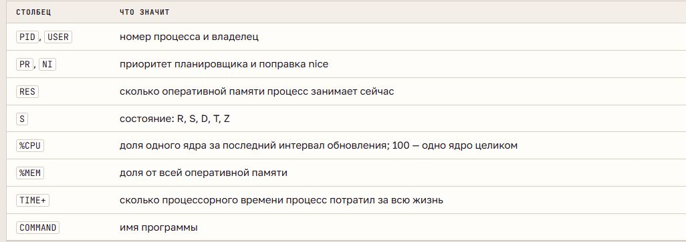
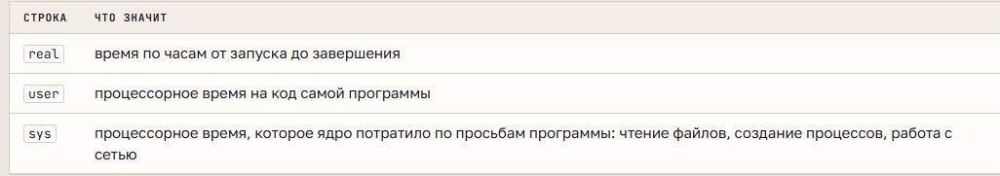

# Диагностика процессов и управление ресурсами

## Ресурсы и нагрузка

**Диагностика** определяет причину симптома по измерениям: общая картина системы → процесс → причина его поведения. Основные ресурсы - CPU, оперативная память, диск и сеть. Медленная работа может быть связана как с вычислениями, так и с ожиданием.

**Load average** - среднее число задач, готовых к выполнению или выполняющихся; в Linux также учитывается непрерываемое ожидание, обычно диска. Три значения соответствуют 1, 5 и 15 минутам. Это не процент загрузки CPU.

Для вычислительной нагрузки значения сравнивают с числом ядер: выше числа ядер - возникает очередь. Если минутное значение больше пятнадцатиминутного, нагрузка недавно выросла. Высокая нагрузка при свободном CPU может указывать на ожидание ввода-вывода.

`uptime` и `/proc/loadavg` показывают нагрузку, `nproc` - число доступных процессоров. В `free` показатель **available** оценивает память, доступную новым программам с учётом освобождаемого кэша.

## Мониторы процессов

**top** обновляет общую сводку и таблицу процессов. В шапке: состояния задач, память и подкачка, CPU - `us` (пользовательский код), `sy` (ядро), `ni` (код с изменённым nice), `id` (простой), `wa` (ожидание ввода-вывода).

`%CPU` в top обычно относится к последнему интервалу, в `ps` - к среднему за жизнь процесса. Процессорное время учитывает выполнение на CPU; время жизни включает ожидание. `RES` и `rss` описывают резидентную память процесса.

В top `P` и `M` меняют сортировку по CPU и памяти, `1` показывает ядра отдельно, `k` отправляет сигнал, `r` меняет nice. **htop** добавляет полосы ресурсов, удобный выбор процесса, поиск и дерево.

## Поиск причины

**ps** даёт неподвижный список с выбранными столбцами и сортировкой: `%cpu` - CPU, `rss` - память. PPID и дерево `pstree` показывают происхождение процесса; `/proc/PID/cwd` - его рабочий каталог, `lstart` и `etime` - начало и длительность работы.

Текущий каталог процесса отличается от расположения программы. У нагрузки может быть несколько процессов с общим родителем; остановка только родителя не гарантирует прекращение их работы.

## Приоритет

**Планировщик** распределяет CPU между готовыми задачами. **Nice** - поправка приоритета от −20 до 19, обычно 0: большее значение уменьшает долю CPU при конкуренции. При свободном процессоре nice не задаёт ограничение скорости.

`nice` относится к запуску новой программы, `renice` - к работающему процессу. Обычно пользователь может увеличить nice своих процессов, а повышение приоритета требует административных полномочий. Nice управляет конкуренцией за CPU и не ограничивает потребление памяти.

## Время и память программы

**time** различает время по часам и процессорное время:

Если `real` намного больше `user + sys`, программа ждёт ресурс или событие. Если CPU-время больше real, работа могла выполняться параллельно на нескольких ядрах. `/usr/bin/time` дополнительно измеряет пиковую память; пик важнее объёма в конце работы для оценки необходимых ресурсов.

## Инцидент и postmortem

**Инцидент** - ухудшение работы системы или службы. Смягчение уменьшает влияние на пользователей, устранение исправляет причину, повторное измерение подтверждает восстановление.

При нехватке RAM подкачка может увеличить ожидание диска. При исчерпании памяти механизм **OOM killer** выбирает и принудительно завершает процесс; сведения остаются в журнале ядра.

**Postmortem** - краткий разбор после инцидента: симптом, причина, действия и профилактика. Он опирается на факты и измерения; профилактическая мера должна быть конкретной и проверяемой.
