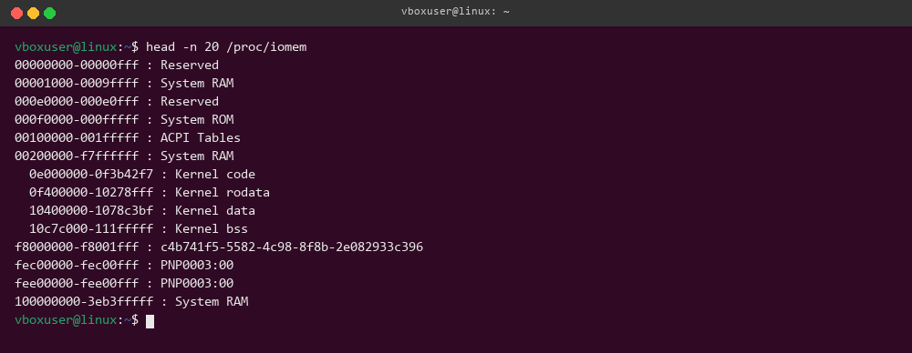
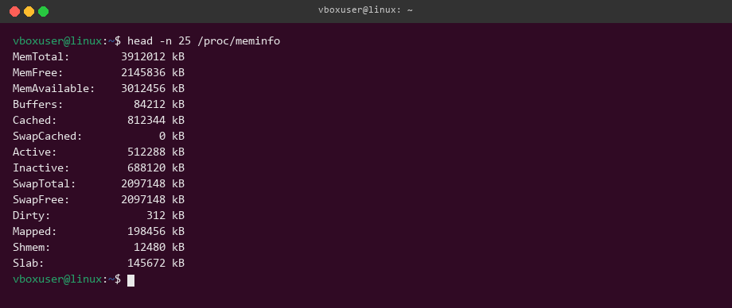
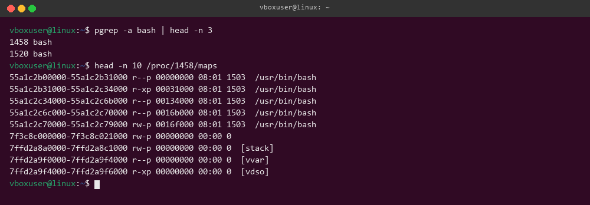
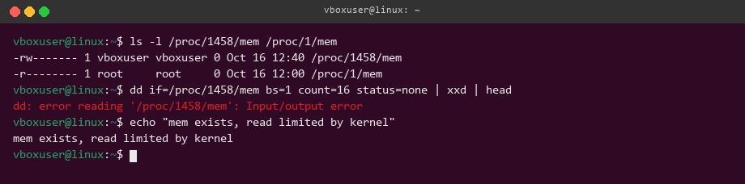

# Управление памятью в Linux

Команды выполнены в Ubuntu. Для проверки выбраны процессы `bash`, `sleep` и `tail`.

## Физическая память

## Состояние памяти

## Карты памяти процессов

## Доступ к памяти процессов

Файл `/proc/PID/mem` существует для каждого процесса, но чтение произвольного участка памяти ограничивается ядром. Это нормальное поведение защиты Linux.
